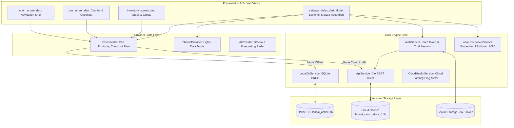

# 🏛️ Architecture Blueprint: LarisAi-Mobile (POS Client Engine)

> **Document Version**: 2.1.0  
> **Target Framework**: Flutter 3.47 / Dart 3.13 (Multi-Platform: Android, Windows Desktop x64)  
> **Master Pattern**: [[01-Architecture-Patterns/multi-mode-pos-pattern|Multi-Mode Smart POS Pattern]]  
> **Central Knowledge Vault**: `d:\porto\knowledge-base\`  

---

## 🗺️ 1. Client High-Level Architecture Flow

---

## 🗂️ 2. Component & Code Map Table

| Modul / Komponen | File Target Utama | Tanggung Jawab & Implementasi |
| :--- | :--- | :--- |
| **App Entrypoint** | `lib/main.dart` | Inisialisasi dependency, window manager (Desktop), provider binding. |
| **Settings & Mode Switcher** | `lib/widgets/settings_dialog.dart` | Modal pop-up 5 tab, pemilihan `ConnectionMode`, accordion login/register SaaS, in-dialog status feedback banner, pre-flight migration modal. |
| **Cross-Mode Data Migration** | `lib/services/data_migration_service.dart` | Migrasi data 2 arah (Lifetime SQLite ⇄ Cloud SaaS), batch upload chunking (50 items), atomic SQLite transaction rollback, Option B clean-slate delete. |
| **State Provider POS** | `lib/providers/pos_provider.dart` | Logic keranjang belanja, kalkulasi subtotal/kembalian, switch mode operasional, sinkronisasi produk. |
| **Auth & Session Service** | `lib/services/auth_service.dart` | Registrasi toko cloud (`registerMerchant`), login JWT (`login`), status lisensi & masa trial 14 hari, error capture `lastError`. |
| **Network REST Client** | `lib/services/api_service.dart` | HTTP client `Dio`, interceptor bearer token, timeout handling, isolasi database multi-tenant (*Anti-Illusion Guard*). |
| **Offline SQLite Engine** | `lib/services/local_db_service.dart` | SQLite FFI (Windows) & SQLite native (Android), operasi CRUD produk, transaksi kasir, dan pembatalan (*Void*). |
| **LAN Host Embedded Server** | `lib/services/local_host_server_service.dart` | Server HTTP lokal desktop di port 8080 (`shelf`), streaming gambar produk ke kasir HP di jaringan Wi-Fi lokal. |
| **Cloud Latency Meter** | `lib/services/cloud_health_service.dart` | Background probe ke Hugging Face cloud, mengukur latency ping (ms), indikator visual status hijau/kuning/merah. |
| **Thermal Printer & PDF** | `lib/widgets/receipt_dialog.dart` & `printer_service.dart` | Generator slip struk kasir thermal 58mm/80mm roll, ekspor PDF, cetak printer ESC/POS Bluetooth/USB. |
| **Lembar Pembayaran SaaS** | `lib/widgets/saas_payment_sheet.dart` | Modal pemilihan paket langganan (Bulanan Rp 49k, Tahunan Rp 399k, LAN Resto Rp 599k), jembatan QRIS Weboz & transfer BCA. |

---

## 🛡️ 3. Failure Modes & Fallbacks

| Kondisi Kegagalan | Resiko Teknis | Fallback & Solusi Permanen |
| :--- | :--- | :--- |
| **Internet Mati saat Mode Cloud Aktif** | Kegagalan transaksi / data kasir tidak tersimpan di cloud. | **Anti-Illusion Guard**: Dilarang diam-diam fallback ke SQLite offline. Tampilkan banner *"Server Terputus"* dengan tombol *"Coba Sambungkan Lagi"* agar kasir sadar status koneksi. |
| **Registrasi SaaS Ditolak Server (401/409)** | User bingung jika notifikasi tertutup modal. | **In-Dialog Reactive Alert Banner**: Tampilkan error langsung di atas tombol submit dengan teks spesifik dari server (merah) tanpa tertutup barrier dialog. |
| **PC Host LAN Tidak Terdeteksi** | Perangkat Android gagal terhubung ke PC kasir utama. | Tampilkan kotak instruksi konfigurasi IP host (`http://<ip>:8080`) dan pastikan kedua perangkat berada di SSID Wi-Fi yang sama. |
